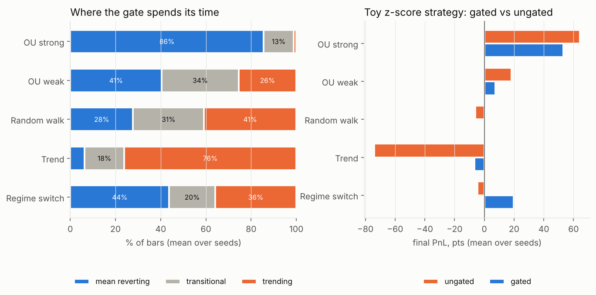
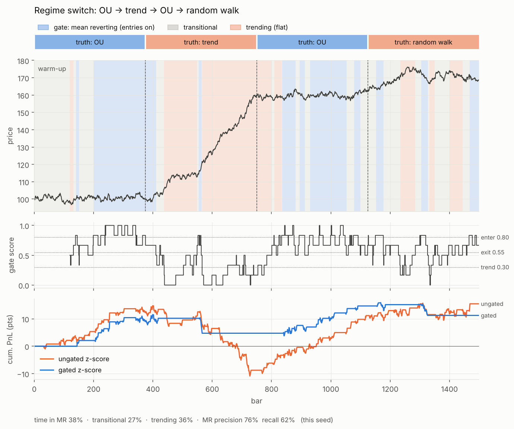
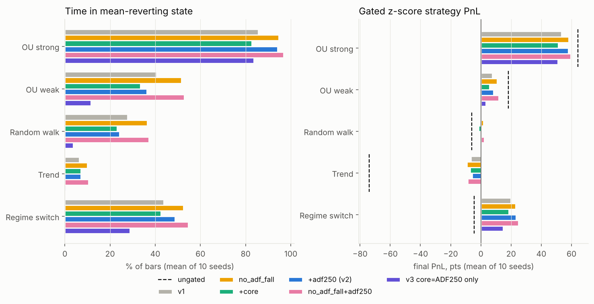
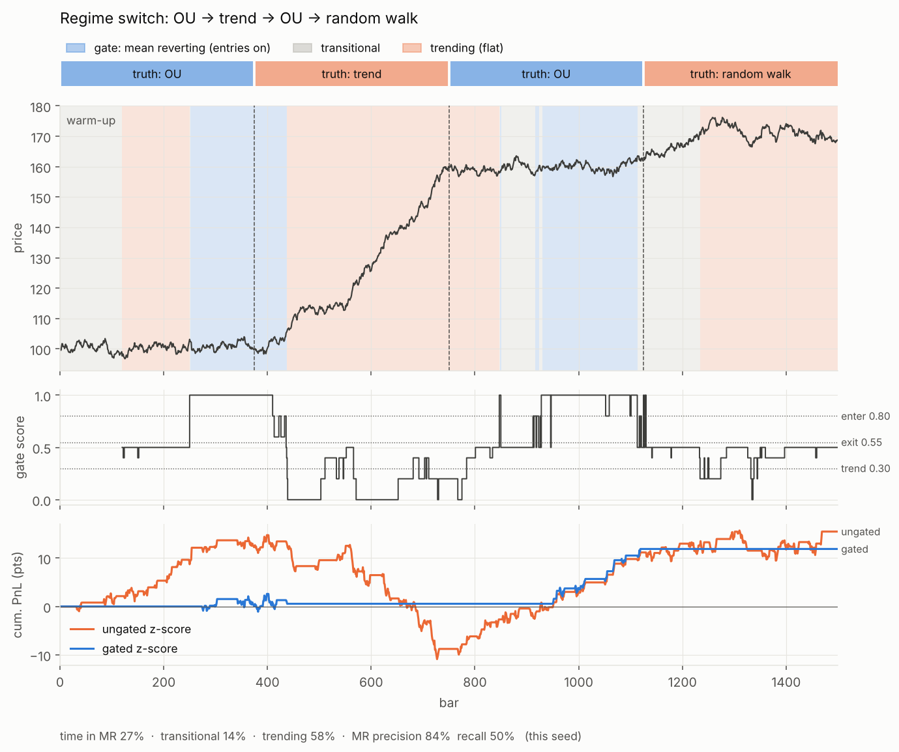

# meanrev_gates_study-0 — Mean-reversion regime gate

A causal regime gate that decides, bar by bar, whether a mean-reversion strategy may
open trades, plus a test harness that runs it on synthetic price processes. Full spec,
session history and findings: [`CONTEXT.txt`](CONTEXT.txt).

## The gate in one paragraph

Each closed bar is scored by six pass/fail checks (Hurst < 0.45, ADF p < 0.05, ADX < 20,
OU half-life in 2–30 bars, half-life stable, ADF p-value falling); the score is the
fraction passing, and a missing feature counts as a fail. A three-state machine with
hysteresis turns the score into a decision: **TRENDING** (no entries, stay flat) →
**TRANSITIONAL** (no new entries, open trades run to their own exits) →
**MEAN_REVERTING** (entries allowed). Entering MR needs score ≥ 0.80 for 3 bars; leaving
needs < 0.55 for 2 bars; TRANSITIONAL drops to TRENDING (forced flat) below 0.30. A
**hard break** (ADX > 30 or Hurst > 0.58) skips confirmation, forces flat and blocks
re-entry for 10 bars. A `blackout` flag (event days, VIX spikes) blocks entries in any
state.

```python
d = gate.on_bar(Features(hurst, adf_pvalue, half_life, adx, blackout))
if d.force_exit:
    close_all()
elif d.allow_entries and abs(z) > 2:
    enter()
```

## Files

| File | What it is |
|---|---|
| `regime_gate.py` | `RegimeGate`, `GateConfig`, `Features`, `GateDecision`, `v2_config()`, `v3_config()`; JSON state save/restore; reference Hurst, OU half-life, ADF, ADX implementations (for parity with a C feature kernel); `python regime_gate.py` runs a small demo |
| `gate_tests.py` | Synthetic scenarios (strong OU, weak OU, random walk, trend, regime switch), a toy z-score strategy run gated vs ungated, figures and `summary.csv` |
| `gate_ablation.py` | v1 vs fix variants (v2, v3) on the same seeds and shared features; writes `results/v2/` |
| `tests/test_regime_gate.py` | Hysteresis, hard break + cooldown, blackout, JSON round-trip, half-life estimator, v2/v3 option checks |
| `results/` | v1 figures and CSV from `gate_tests.py`; `results/v2/` ablation table, comparison chart and v3 per-scenario figures |

## Run

```bash
pip install -r requirements.txt
python gate_tests.py 10        # v1, 10 seeds per scenario, ~2 min; writes results/
python gate_ablation.py 10     # v1 vs v2/v3 ablation, ~3 min; writes results/v2/
python -m pytest -q tests
```

## Results (10 seeds × 1,500 bars, 120-bar feature window)

| Scenario | Time in MR | Ungated PnL | Gated PnL |
|---|---|---|---|
| Strong OU (half-life ≈ 6.6) | 86% | +64 | +53 |
| Weak OU (half-life ≈ 34) | 41% | +18 | +8 |
| Random walk | 28% | −6 | 0 |
| Trend | 6% | −74 | −7 |
| Regime switch | 44% | −5 | +20 |

Regime switch: MR precision 72%, recall 69%; median lag 16 bars to leave MR after a
regime ends, 60 bars to re-enter after mean reversion resumes.




## Findings

- The gate does its main job: trend losses fall from −74 to −7, and the regime-switch
  run turns from a loss into a profit.
- It is too permissive on a random walk (on 28% of the time). Per-check pass rates on a
  random walk: Hurst 48%, **ADF 2%**, ADX 58%, half-life range 64%, half-life stable 70%,
  **ADF falling 52%** (vs 56% on strong OU — it carries no information).
- Re-entry lag is set by the window length: the window keeps seeing the old regime.

## Fix attempt: v2 and v3 (`gate_ablation.py`, results in `results/v2/`)

Fixes are switches on `GateConfig` (defaults still reproduce v1): `use_adf_falling`,
`require_core` + `core_hurst_max` (mandatory "ADF passes OR Hurst < x"; failing caps the
score at `core_fail_cap` = 0.50, so it blocks or leaves MR without forcing flat), and the
ADF window is chosen on the feature side. `v2_config()` = drop adf_falling + core
(ADF or Hurst < 0.40); `v3_config()` = core is ADF alone. Both fed ADF on 250 bars.
Same 10 seeds; features computed once and shared by all variants.

| Variant | OU strong MR% | Random walk MR% | Trend MR% | Trend PnL | Regime switch PnL | Precision / recall | Lag out / in |
|---|---|---|---|---|---|---|---|
| v1 | 86 | 28 | 6.3 | −6.6 | +19.8 | 72 / 69 | 16 / 60 |
| drop adf_falling | 95 | 37 | 10.0 | −9.3 | +23.0 | 70 / 79 | 36 / 56 |
| + core (ADF120 or H<0.40) | 83 | 23 | 7.1 | −7.0 | +18.4 | 73 / 68 | 22 / 56 |
| + ADF250 = **v2** | 94 | 24 | 7.0 | −5.9 | +23.2 | 74 / 78 | 58 / 63 |
| drop adf_falling + ADF250 | 97 | 37 | 10.5 | −8.8 | +24.8 | 71 / 84 | 58 / 61 |
| **v3** (core = ADF250 only) | 84 | **3.6** | **0.5** | **−0.2** | +14.8 | **82** / 51 | 22 / 97 |

Ungated PnL: OU strong +64, random walk −6, trend −74, regime switch −5. Gated PnL has a
seed-to-seed sd of ~6–13 pts, so PnL gaps between variants under ~10 pts are noise; the
MR% columns are the more reliable signal.




What the ablation shows:

- **Dropping `adf_falling` alone makes things worse.** With 5 checks the 0.80 entry bar
  means 4 of 5 instead of 5 of 6, so the gate gets *more* permissive (random walk 28→37%).
- **v2 barely helps (random walk 28→24%).** Its mandatory test passes through Hurst: the
  120-bar Hurst estimator reads a median **0.45 on a pure random walk** and is < 0.40 on
  32% of windows, so "ADF or Hurst" passes 35% of the time on random walks and trends.
- **ADF on 250 bars is the sharp test:** p < 0.05 on 95% of strong-OU windows, 4% of
  random-walk windows, 1% of trend windows.
- **v3 fixes the false positives:** random walk 28→3.6%, trend 6.3→0.5% with the trend
  loss gone, precision 72→82%, and strong OU keeps 84% (same as v1).
- **v3's price is recall and re-entry speed:** recall 69→51% and re-entry lag 60→97 bars,
  since 250 bars must pass before ADF re-confirms. Part of the recall loss is the backtest
  warm-up (no ADF before bar 250, which costs ~130 truly-MR bars); live, the history
  would already be there. Weak OU (half-life ≈ 34) is now mostly rejected (11%).

**Which to use:** v3 if a false "on" is expensive (real costs, slippage, MCX thin books),
v1/v2 if missing mean-reverting stretches is the bigger cost. v3 is the safer default.

## Next steps

1. Speed up v3's re-entry without reopening false positives, e.g. ADF on 250 bars for
   *entry* but the faster 120-bar checks plus hard break for *exit*, or a 180-bar ADF.
2. Replace the 120-bar Hurst (biased low) with a bias-corrected estimator or a longer
   window, or drop it from the score.
3. Repeat with realistic costs and more seeds (≥ 50) so PnL differences are resolvable.
4. Calibrate on Nifty/BankNifty/MCX, scoring thresholds on gated PnL net of costs.
